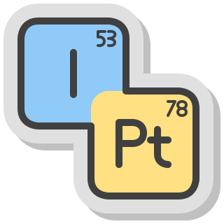

<p align="center">

</p>

[](https://github.com/mgimpel/periodic-table-app?tab=BSD-3-Clause-1-ov-file) [](https://pnpm.io/) [](https://nodejs.org/en/about/previous-releases) [](https://tauri.app/)
[](https://vite.dev/) [](https://react.dev/)
[](https://mantine.dev/)

# Periodic Table App

The Periodic Table project aims de develop a lightweight interactive Periodic Table of Elements, with a simple interface that displays the table of elements. When you click or select an element from the table more detailed information about the element will be displayed.

It is targeted primarily at mobile phones and tablets (Android, iPhone, iPad). Desktop (Windows, Mac, Linux) and web access are a secondary target.

From a technical point of view, the application will be built using [Tauri](https://v2.tauri.app/) cross-platform framework with a [React](https://react.dev/) frontend. The UI should use the [Mantine](https://mantine.dev/) components.

## Recommended IDE Setup

- [VS Code](https://code.visualstudio.com/) + [Tauri](https://marketplace.visualstudio.com/items?itemName=tauri-apps.tauri-vscode) + [rust-analyzer](https://marketplace.visualstudio.com/items?itemName=rust-lang.rust-analyzer)

## Test, Build and run

Make sure you have installed the prerequisites for your OS: https://tauri.app/start/prerequisites/, then run:

### Desktop (Windows, Mac and Linux) build and run

To initialise environment:
```bash
cd periodic-table-app
pnpm install
```

To run:
```bash
cd periodic-table-app
pnpm tauri dev
```

To build:
```bash
cd periodic-table-app
pnpm tauri build
```

To preview in your web browser (works because the rust backend doesn't actually do anything, it's all React frontend):
```bash
cd periodic-table-app
pnpm build
pnpm preview
```

### Mobile (Android and iOS) build and run

To initialise environment:
```bash
cd periodic-table-app
pnpm android init
```

To run:
```bash
cd periodic-table-app
pnpm android tauri dev
```

To build:
```bash
cd periodic-table-app
pnpm android tauri build
```

NB: Same for iOS, just change `android` for `ios` in the above commands.

### Testing

To run all the test (*.test.ts & *.test.tsx)
```bash
pnpm test
```

To run all the checks (*.check.ts)
```bash
pnpm check
```

## Update dependencies

See https://v2.tauri.app/develop/updating-dependencies/
```
pnpm update @tauri-apps/cli @tauri-apps/api --latest
cd src-tauri/
cargo update
```
